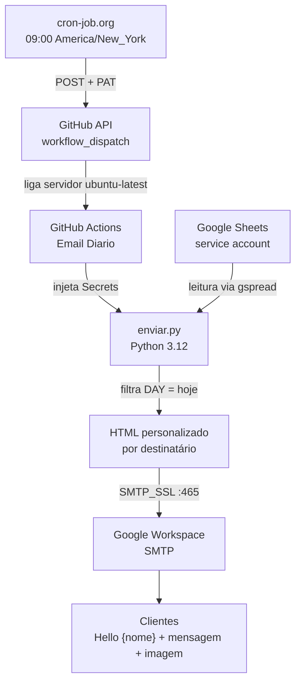

# 📬 Automação de E-mails Diários para Clínica de Saúde Mental

Automação 100% em nuvem que **dispara e-mails personalizados diariamente** a partir de um calendário de conteúdo em Google Sheets, usando Python, GitHub Actions e agendamento externo com fuso horário nativo (America/New_York).

Entrega da disciplina **Prática Extensionista** — PUCPR (Inteligência Artificial).

---

## 1. Visão geral

O sistema **elimina a tarefa manual de envio de e-mails diários** de uma clínica de saúde mental, liberando tempo da equipe para o atendimento clínico.

- **O que faz:** lê diariamente uma planilha Google com mensagens programadas por data, filtra a do dia atual, monta um e-mail HTML personalizado para cada destinatário e envia via SMTP do Google Workspace.
- **Para quem:** pacientes, líderes comunitários e assistentes sociais em formação atendidos pela clínica.
- **O que entrega:** e-mails personalizados saindo da conta oficial da clínica, todo dia às 09h00 no fuso da Flórida, sem necessidade de computador ligado.

## 2. Contexto, problema e solução

**Problema.** A clínica mantinha a rotina de enviar diariamente um e-mail com reflexão e imagem para sua lista de contatos. A tarefa era repetitiva, consumia tempo operacional e dependia da disponibilidade de uma pessoa específica.

**Solução.** Automatizar o ciclo em 4 etapas:

1. **Agendamento** — cron-job.org dispara o workflow todo dia às 09:00 ET (com horário de verão automático).
2. **Orquestração** — GitHub Actions liga um servidor na nuvem, injeta credenciais via Secrets e executa o script.
3. **Processamento** — o Python lê a planilha via service account, filtra a mensagem do dia no fuso da Flórida e monta o e-mail.
4. **Entrega** — envio via SMTP do Workspace para cada destinatário, com pausa anti-sobrecarga entre envios.

## 3. Diagrama do pipeline



## 4. Estrutura do repositório

```text
automacao-email/
├── README.md                   # Este arquivo
├── index.html                  # Documentação navegável em HTML
├── enviar.py                   # Script principal (versão sanitizada)
├── requirements.txt            # Dependências (gspread, tzdata)
├── .gitignore                  # Exclui credentials.json, __pycache__
├── LICENSE                     # MIT
├── exemplos/
│   └── enviar.yml              # Workflow de produção (como referência)
└── docs/
    ├── apresentacao.md         # Contexto e justificativa
    └── feedback-exemplos.md    # Exemplos de feedback dos destinatários
```

> ⚠️ **Repositório de demonstração:** credenciais reais, e-mails de clientes e o ID da planilha **não** são incluídos. Em produção, todos os segredos são injetados via GitHub Secrets e service account do Google Cloud.

## 5. Stack utilizada

| Item | Versão / observação |
|---|---|
| Python | 3.12 |
| `gspread` | leitura do Google Sheets via service account |
| `tzdata` | suporte a `zoneinfo` (fuso da Flórida) |
| `smtplib` | envio via SMTP (stdlib) |
| GitHub Actions | execução na nuvem (`ubuntu-latest`) |
| cron-job.org | agendamento com timezone nativo |
| Google Workspace SMTP | `smtp.gmail.com:465` |
| Google Cloud | service account com acesso de leitura à planilha |

## 6. Setup e execução (reproduzir localmente)

### 6.1 Clonar e instalar

```bash
git clone <url-do-repositorio>
cd automacao-email
python -m venv .venv
pip install -r requirements.txt
```

### 6.2 Credenciais necessárias

1. **Service account do Google Cloud** → gerar chave JSON e salvar como `credentials.json` (não versionada).
2. **Compartilhar a planilha** com o `client_email` da service account.
3. **App password do Workspace** → gerar em myaccount.google.com → Segurança → Senhas de app.

### 6.3 Executar

```bash
export GMAIL_USER="usuario@dominio.com"
export GMAIL_APP_PASS="xxxx xxxx xxxx xxxx"
python enviar.py
```

No Windows (cmd):

```cmd
set GMAIL_USER=usuario@dominio.com
set GMAIL_APP_PASS=xxxx xxxx xxxx xxxx
py enviar.py
```

## 7. Decisões técnicas justificadas

- **n8n → GitHub Actions.** O projeto iniciou no n8n, mas com o fim do período gratuito optou-se por uma solução autônoma e gratuita, gerando **economia para a clínica** e **mais segurança dos dados** — aspecto crítico em saúde mental, onde o sigilo é essencial.
- **Google Apps Script como backup.** Uma versão paralela foi desenvolvida em Apps Script; funcionou na nuvem, mas virou apenas histórico com trigger desativado.
- **PythonAnywhere descartado.** Scheduled tasks viraram recurso pago no plano gratuito — inviabilizou o uso.
- **cron-job.org em vez do cron nativo do GitHub.** O gatilho `schedule` do GitHub Actions mostrou instabilidade em repositórios novos (disparos irregulares). O cron-job.org foi adotado como relógio oficial porque oferece fuso horário nativo e trata automaticamente o horário de verão americano.
- **Fuso da Flórida via `zoneinfo`.** Em vez de cálculos manuais de UTC, o Python usa `ZoneInfo("America/New_York")` — imunidade total a mudanças sazonais.
- **Credenciais via GitHub Secrets.** Nenhum segredo no código; o `enviar.py` usa apenas `os.environ.get(...)` com placeholders.
- **PAT fine-grained.** Escopo mínimo (Actions read/write em 1 único repositório) — boa prática de segurança em vez de PAT clássico com permissões globais.
- **Pausa de 1s entre envios.** Evita sobrecarga do SMTP do Google e reduz risco de bloqueio por volume.
- **Dia sem mensagem = silêncio.** O sistema não gera e-mail vazio quando a planilha não tem a data de hoje — comportamento intencional que evita mensagens sem conteúdo.

## 8. Evidências de funcionamento

### 8.1 Execução típica (log real)

```text
[2026-10-XX] Consultando planilha...
[2026-10-XX] Mensagem do dia encontrada
[2026-10-XX] Enviado para cliente1@exemplo.com
[2026-10-XX] Enviado para cliente2@exemplo.com
[...]
[2026-10-XX] Concluído: 12 e-mail(s) enviado(s).
```

### 8.2 Exemplo de e-mail entregue

- **Remetente:** Nome da Clínica <email@dominio.com>
- **Assunto:** How are you going {nome}?
- **Corpo HTML:** saudação personalizada (`Hello {nome} - [mensagem do dia]`) + imagem embutida.

### 8.3 Monitoramento

- **GitHub Actions → aba Actions:** log completo de cada execução com status verde/vermelho.
- **cron-job.org:** histórico de disparos + notificação de falha ativada.
- **Dia sem mensagem:** log registra `Nenhuma mensagem para hoje. Nada será enviado.` (comportamento normal).

## 9. Segurança

- Repositório de produção **privado**; este repositório é público e de demonstração.
- Segredos apenas em GitHub Secrets e no cron-job.org (header do job).
- PAT fine-grained com escopo mínimo.
- Service account com acesso de **leitura** apenas à planilha.
- App password em vez da senha real da conta.
- Credenciais locais existem apenas para testes manuais e **nunca são commitadas**.

## 10. Roadmap

- [ ] Layout HTML com identidade visual da clínica (cores, logo, botão).
- [ ] Coluna `ATIVO` na Página1 para pausar destinatários sem excluir.
- [ ] Registrar status de envio de volta na planilha (coluna `LAST SENT`).
- [ ] Mensagens segmentadas por grupo de clientes (incl. versão em português).
- [ ] Anexos reais (PDF) além da imagem embutida.

## 11. Relação com ODS e ESG

- **ODS 3 — Saúde e Bem-estar:** fortalece processos de saúde mental.
- **ODS 8 — Trabalho decente:** reduz carga operacional da equipe clínica.
- **ODS 9 — Indústria, inovação e infraestrutura:** implementa solução tecnológica real.
- **ODS 17 — Parcerias:** colaboração universidade–empresa internacional.
- **ESG — Governança:** padroniza comunicação e reduz falhas administrativas.

---

### Autora

**Emily Cristofoleti** — Prática Extensionista · PUCPR (Inteligência Artificial)
